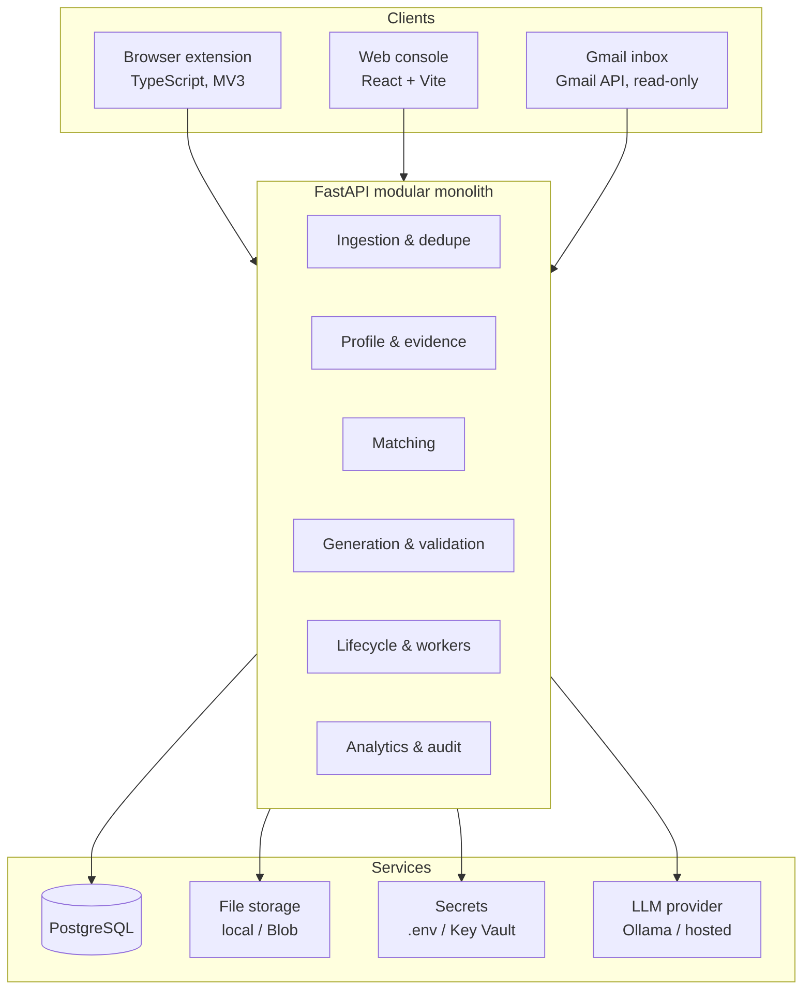
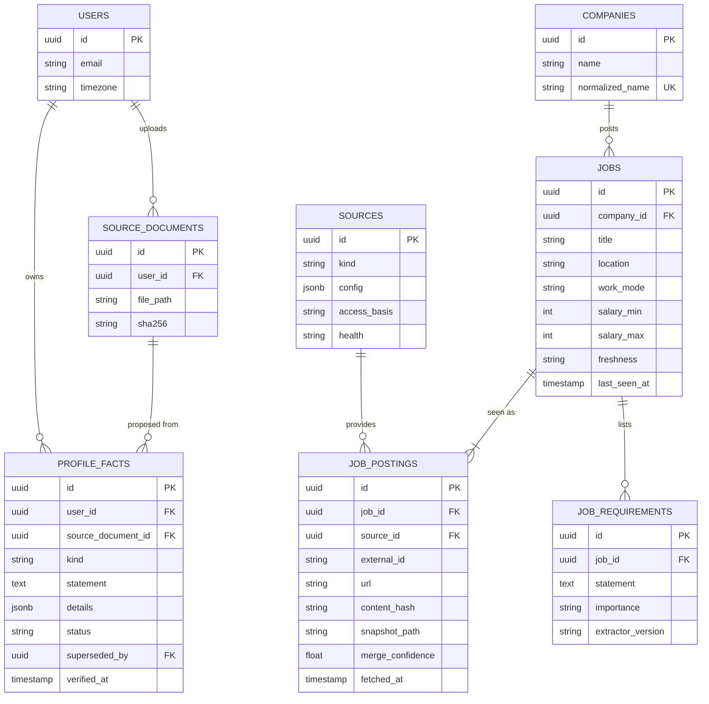
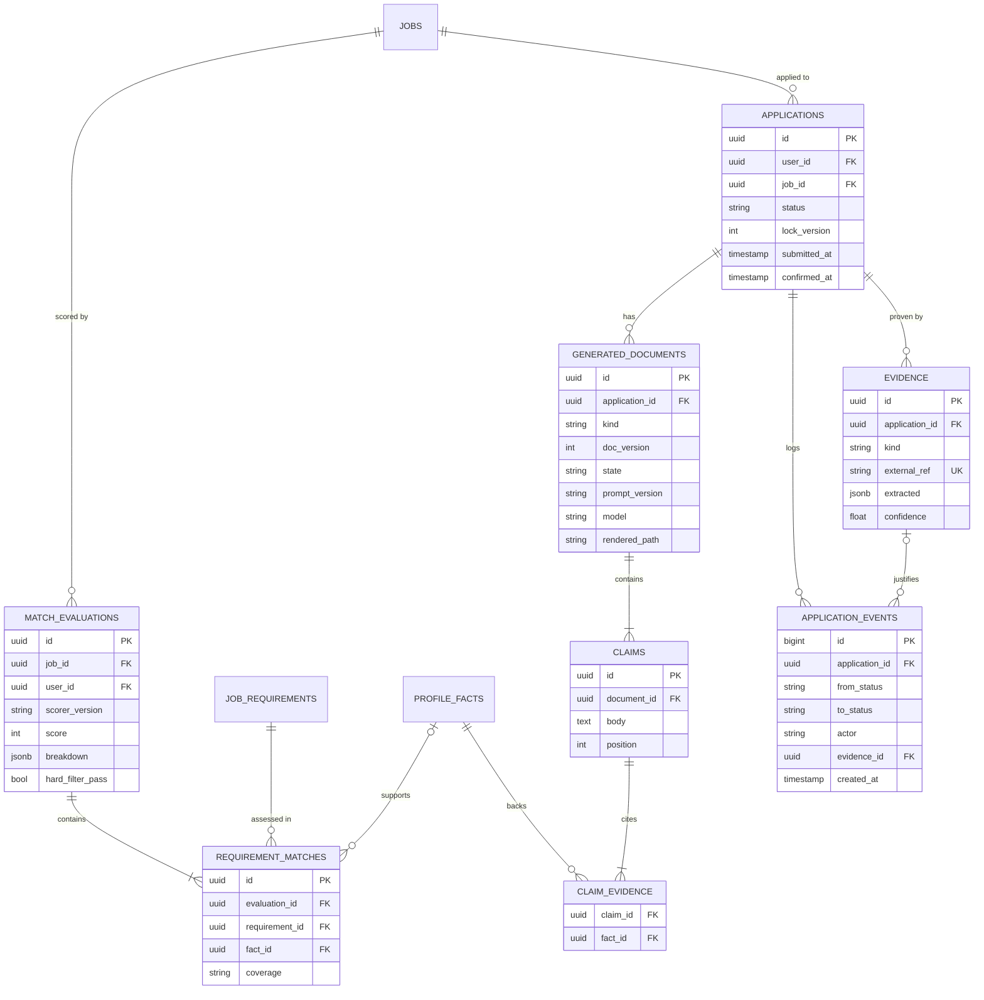

# AI-Assisted Job Application System — Design Document

| | |
|---|---|
| **Status** | Draft v0.1 — design phase, no code yet |
| **Date** | 13 October 2026 |
| **Scope** | Personal-use MVP, zero running cost |
| **Guiding principle** | Build a trustworthy, measurable job-search and application system — not another bot that clicks Apply. |

---

## Table of contents

1. Purpose and principles
2. Competitive research
3. Platform access and compliance
4. Personas and use cases
5. Requirements
6. MVP scope
7. Submission strategy
8. Architecture
9. Technology stack
10. Deployment and cost
11. Data model
12. Key design decisions
13. Application lifecycle (draft)
14. Privacy and security
15. Testing and evaluation
16. How it works, in plain language
17. Open questions and verification checklist
18. Next steps

---

## 1. Purpose and principles

The system helps one job seeker find relevant jobs, understand how well each one fits, prepare honest tailored applications, submit them with minimal effort, and track what actually happened. It is built first for personal use during an active job search, and designed so it could later grow into a multi-user product.

Five principles govern every decision below.

| Principle | What it means in practice |
|---|---|
| **No fabrication** | Every factual claim in a generated application cites a fact the candidate has verified. Uncited claims are blocked before review. |
| **Evidence over assumption** | An application is "confirmed" only when there is external evidence (a confirmation page or email), never just because a button was clicked. |
| **Authorized access only** | No scraping where prohibited, no CAPTCHA bypass, no stealth or anti-bot evasion. The human presses Submit. |
| **Explainable, not opaque** | Scores are computed in code from a visible requirement checklist, not invented by an LLM. |
| **Simplest thing that works** | A modular monolith on PostgreSQL. Frameworks and services are added only when a concrete problem demands them. |

---

## 2. Competitive research

### 2.1 Method and status

The two open-source repositories were checked directly against their READMEs and project documents on 13 October 2026. Naukri NEO and Simplify could not be checked from the research environment; their entries come from preliminary notes and memory and are marked **V** until verified against official pages. "Confirmed" for a repository means *documented as shipped*, not independently run.

**Legend:** **C** Confirmed · **P** Partially supported · **N** Planned / not implemented · **ND** Not documented · **V** Requires verification

### 2.2 Feature matrix

| Feature | Naukri NEO | AutoApply (Liam Frost) | Job Application Agent (Fahad Noufal) | Simplify |
|---|---|---|---|---|
| Job discovery sources | V (Naukri only) | C — LinkedIn + Greenhouse, Lever, Workday, Ashby, iCIMS | C — Naukri, Internshala | V |
| Unified normalized job index | V | C | P — per-platform schemas | V |
| Cross-source dedupe | V | N — explicitly not promised | P — exact URL only | V |
| Freshness / stale-listing check | V | C — includes pre-submit gate | ND | V |
| Fit scoring | V | C — rules + semantic | P — LLM yes/no filter | V |
| Explanation of fit / rejection | V | C | ND | V |
| Structured candidate profile | V | C — profile, story bank, bullet pool, Q&A | P — CLI answers + pasted resume | V |
| Tailored resume | V | C | ND | V |
| Cover letter | ND / V | C | ND | V |
| Evidence-grounded claims | V | C (as documented; mechanism not inspected) | ND | V |
| Form autofill | V | N | C — Internshala forms, Naukri chatbot | V |
| Automated submission | V | N | C — fully automated mode | V |
| Human approval gate | V | C | C — semi-automated mode | V |
| Confirmed-submission evidence | V | N — refuses to fake it | P — Naukri success message only | V |
| Durable workflow state / recovery | V | C — Postgres, Celery, dead-letter queue | P — stage checkpoints | V |
| Duplicate-submission prevention | V | ND | C | V |
| Outcome tracking | V | P — manual; sync on backlog | ND | V |
| Outcome analytics by resume version | V | ND | ND | V |
| LLM choice / local models | N/A | C — ~14 providers incl. Ollama | C — Gemini only | N/A |
| LLM cost telemetry | N/A | C | ND | N/A |
| Personal data encrypted at rest | V | ND | C — Fernet | V |
| License | Proprietary | PolyForm Noncommercial 1.0.0 | MIT | Proprietary |

### 2.3 Notable findings

**AutoApply** is mature (v0.18.9; 1,720 tests reported passing on 21 May 2026) and overlaps heavily with this project's matching, generation, review, and privacy goals. Its documented gaps are browser form-fill, click-submit, outcome status sync, saved-search fanout, and cross-source dedupe. Its license allows free personal use; commercial use requires a separate license from the author. Its Phase 20 roadmap mentions a possible residential-proxy "escape hatch" for anti-bot-protected sites — a direction this project will not follow.

**Job Application Agent** actively automates Naukri and Internshala with Playwright and LangGraph, with a semi-automated review mode. It is MIT-licensed. It advertises "human-like" randomized timing and suggests increasing delays when CAPTCHAs appear; that is evasion-adjacent and conflicts with this project's compliance rules. It is useful as a reference for workflow structure only.

### 2.4 Differentiators assessed

| Differentiator | Achievable? | Assessment |
|---|---|---|
| A. Unified job intelligence | Partly | Cross-source dedupe is a real gap, but only valuable once several legitimate sources exist. |
| B. Explainable matching | Yes, not unique | AutoApply has it. Our angle: per-requirement mapping to specific verified facts. |
| C. Evidence-backed generation | **Yes — strongest** | Make it verifiable: claims stored as rows with fact citations, enforced by a validator. |
| D. Lifecycle with confirmation | **Yes — clear gap** | No verified competitor separates attempted from confirmed using external evidence. |
| E. Resilient execution | Yes | Table stakes, not a differentiator. |
| F. Outcome analytics | Yes, slow to prove | One person's volume is small; ship descriptive analytics before any recommendations. |
| G. Privacy and cost control | Yes, partial | Local-first, free to run, portable. |

**Positioning:** an India-market-aware job-search copilot with verifiable, evidence-cited applications and confirmed outcome tracking, built only on authorized access.

---

## 3. Platform access and compliance

Platform terms below reflect current understanding and **must be verified against each platform's official terms before any adapter is built.**

| Rank | Platform | Approach | Rationale |
|---|---|---|---|
| 1 | **Company ATS forms** (Greenhouse, Lever, Ashby; Workday later) | Listings from public job-board APIs; extension autofill triggered by the user | Officially public listings; standardized forms; established precedent for user-triggered autofill. Candidate-side submission APIs generally require the employer's key, so are not usable. |
| 2 | **Naukri** | Full auto-apply via Naukri NEO (Naukri's own sanctioned tool); our system imports and tracks those applications from emails | The only sanctioned fully automated route on the list. NEO pricing and availability need checking. |
| 3 | **Cutshort, Hirist** | Extension autofill, only after confirming terms permit it | Smaller, simpler forms; terms unknown. |
| 4 | **LinkedIn** | Tracking only, from job-alert and confirmation emails | Most restrictive towards automation; the account at risk is the user's professional profile. |

**Explicitly out of scope:** CAPTCHA solving, stealth browsers, fingerprint spoofing, simulated human mouse movement, proxy rotation, and any technique intended to defeat bot detection. Besides breaching platform terms, these risk bans on the user's own accounts and create a permanent maintenance arms race.

Each source adapter declares its `access_basis` (for example "public ATS API", "user's own inbox", "user-triggered autofill"), recorded in the `sources` table.

---

## 4. Personas and use cases

### 4.1 Personas

**P1 — Active seeker (primary).** Software engineer in India, 2–6 years of experience, applying to 20–50 roles a month across Naukri, LinkedIn, Cutshort, and startup career pages. Pains: rewriting the same bullets, losing track of applications, never learning what works.

**P2 — Passive seeker.** Employed, wants a short weekly digest of genuinely high-fit roles with honest explanations. Values ranking quality and low noise.

**P3 — Coach or placement cell (deferred).** Manages several candidates. Out of MVP scope; kept in mind by putting `user_id` on every top-level table.

### 4.2 Worked example

1. A LinkedIn alert email arrives for "Backend Engineer, Bengaluru, Acme". The same role is also on Acme's Greenhouse board; both postings merge into one job.
2. Requirements extracted: Python (must), PostgreSQL (must), Kafka (preferred), 3+ years (must).
3. Mapping: Python → F12, PostgreSQL → F18, experience → F3 (4 years). Kafka has no supporting fact and is flagged as a gap.
4. Hard filters pass; score 78 with a visible breakdown.
5. Generated bullets each cite fact IDs. A draft bullet claiming Kafka experience is rejected by the validator before review.
6. The user approves, opens the Greenhouse form, clicks **Fill**, reviews, and clicks **Submit**.
7. The extension captures the confirmation page; a "Thanks for applying" email follows. Status becomes **Submission confirmed**, with both pieces of evidence linked.
8. Three weeks later a rejection email moves it to **Rejected**, counted against resume variant B, backend roles, Greenhouse source.

### 4.3 Use cases

| ID | Use case | Actor |
|---|---|---|
| UC1 | Build profile from resume and verify each fact | P1, P2 |
| UC2 | Ingest jobs from pasted text/URL, ATS boards, or alert emails | System, P1 |
| UC3 | Evaluate fit with explanation and gaps | System |
| UC4 | Prepare evidence-cited application content | System |
| UC5 | Review, edit, and approve content | P1 |
| UC6 | Autofill and submit via the browser extension | P1 |
| UC7 | Confirm submission and track outcomes from evidence | System, P1 |
| UC8 | Review funnel and outcome analytics | P1 |
| UC9 | Resolve items in the manual-intervention queue | P1 |

---

## 5. Requirements

Priority uses MoSCoW: **M** must, **S** should, **C** could, **W** won't (for now).

### 5.1 Functional requirements

| ID | Requirement | Pri |
|---|---|---|
| **Profile** | | |
| FR1 | Store the profile as atomic facts with ID, source document, and status (proposed / verified / rejected / superseded) | M |
| FR2 | Parse an uploaded resume into proposed facts; only verified facts are usable for generation | M |
| FR3 | Maintain a reusable answer bank with a last-confirmed date | M |
| **Ingestion** | | |
| FR4 | Accept pasted job description text or URL | M |
| FR5 | Poll configured public ATS boards (Greenhouse, Lever, Ashby) | S |
| FR6 | Parse job-alert emails into jobs | S |
| FR7 | Normalize all jobs into one schema and keep the raw snapshot | M |
| FR8 | Merge cross-source duplicates into one canonical job; allow manual split | S |
| FR9 | Mark stale jobs and warn before submission | S |
| **Matching** | | |
| FR10 | Apply deterministic hard filters before any LLM call | M |
| FR11 | Extract requirements, labelled must or preferred | M |
| FR12 | Map each requirement to fact IDs or mark it as a gap | M |
| FR13 | Compute a score in code from the mapping, with a component breakdown | M |
| **Generation** | | |
| FR14 | Generate tailored bullets, summary, and screening answers, each claim citing fact IDs | M |
| FR15 | Validate output (no uncited claims, no unknown or unverified facts, schema-valid); bounded retries, then escalate | M |
| FR16 | Generate cover letters | C |
| FR17 | Version every generated document and record which version each application used | M |
| **Review and submission** | | |
| FR18 | Review queue with inline edits saved as new versions | M |
| FR19 | Browser extension autofills supported forms when the user clicks Fill | M |
| FR20 | Extension records the submission attempt and captures the confirmation page | M |
| FR21 | Fallback packet export (PDF resume + answers sheet) and manual "submitted" action for unsupported sites | M |
| FR22 | Unattended automated submission | W |
| **Lifecycle and outcomes** | | |
| FR23 | Persistent state machine distinguishing attempted from confirmed submission | M |
| FR24 | Classify emails (confirmation, rejection, interview, assessment, other) and link them as evidence | S |
| FR25 | Route low-confidence email matches to the manual queue | S |
| FR26 | Manual outcome entry as a fallback | M |
| **Analytics and operations** | | |
| FR27 | Funnel counts by source, role category, and resume variant | S |
| FR28 | Per-call LLM token and cost logging, rolled up per application | M |
| FR29 | Append-only audit log of every state change and external action | M |

### 5.2 Non-functional requirements

| ID | Requirement | Target / measurement |
|---|---|---|
| NFR1 | No fabrication | 0 uncited factual claims reach review; checked on a hand-audited sample |
| NFR2 | Privacy | Personal data encrypted at rest; secrets in Key Vault or OS keychain; no raw email bodies retained |
| NFR3 | Reliability | No lost or double-counted application after a crash; transactional, idempotent transitions |
| NFR4 | Cost | ₹0 running cost; Azure usage within student credit with budget alerts |
| NFR5 | Compliance | No prohibited scraping or evasion; each adapter declares its access basis |
| NFR6 | Explainability | Every score and claim traceable to inputs from the UI |
| NFR7 | Portability | Same container image runs locally and on Azure |
| NFR8 | Extensibility | New source or form adapter added without changing core modules |
| NFR9 | Latency | Application preparation under 60 s hosted, under ~90 s with a local model |

---

## 6. MVP scope

**In the MVP:** profile with fact verification; ingestion from pasted descriptions, Greenhouse/Lever boards, and Gmail job alerts; hard filters and requirement mapping; evidence-cited generation with validator; review queue; browser extension for Greenhouse and Lever; confirmation capture from the extension and from email; outcome tracking; basic funnel analytics; LLM cost logging.

**Deferred:** Ashby and Workday adapters; Cutshort and Hirist (pending terms); cover letters; pgvector-based fuzzy dedupe (only if text matching is insufficient); Datadog; multi-user support.

**Not planned:** unattended submission, any anti-bot evasion, LinkedIn form automation.

---

## 7. Submission strategy

The time-consuming part of applying is filling forms and tailoring content, not the final click. The system therefore automates everything up to the click and leaves the click to the user.

**Browser extension (TypeScript, Chrome Manifest V3).** Runs in the user's own logged-in browser. On a supported application page the user clicks **Fill**; the extension requests the approved packet from the backend, fills fields, uploads the tailored resume, and inserts screening answers. The user reviews and clicks **Submit**. The extension then reads the confirmation page and sends it to the backend as evidence.

Each site is a separate adapter (field mapping, confirmation detection), so a change on one site does not affect others. Greenhouse and Lever come first. Saved page fixtures are used to test adapters without touching live sites.

**Naukri.** Users who want hands-off applying there can enable Naukri NEO. Our system picks those applications up from confirmation emails and tracks outcomes alongside everything else.

**Unsupported sites.** Export the packet (PDF + answers sheet) and mark the application submitted manually; email evidence can still confirm it later.

---

## 8. Architecture

A **modular monolith**: one FastAPI application and one background worker, sharing one codebase and one PostgreSQL database. Modules have clear boundaries and talk through in-process interfaces, so any one could later be split out if it ever needed to be.

| Module | Responsibility |
|---|---|
| Ingestion & dedupe | Source adapters, normalization, canonical job merging, freshness |
| Profile & evidence | Resume parsing, fact proposal and verification, answer bank |
| Matching | Hard filters, requirement extraction, requirement-to-fact mapping, scoring |
| Generation & validation | Tailored content as structured claims, citation validator, PDF rendering |
| Lifecycle & workers | Application state machine, background jobs, retries, manual queue |
| Analytics & audit | Funnel metrics, LLM cost roll-ups, audit log views |

---

## 9. Technology stack

| Layer | Choice | Reason |
|---|---|---|
| Backend | Python 3.12, FastAPI, Pydantic v2 | Strongest LLM and text-processing ecosystem; Pydantic validates both API input and LLM output |
| Data access | SQLAlchemy 2, Alembic | Mature ORM with versioned migrations |
| Database | PostgreSQL | One store for jobs, facts, applications, audit log, and job queue |
| Similarity | pgvector (only if needed) | Fuzzy dedupe inside the same database; no separate vector store |
| Background jobs | Procrastinate (Postgres-backed) | Retries, scheduling, and crash safety without Redis or Celery |
| Fuzzy text matching | rapidfuzz | Cheap first pass for dedupe before any embeddings |
| LLM access | Provider SDK behind a small internal interface; Pydantic structured output | Swap providers by configuration; Ollama locally |
| Resume rendering | Jinja2 HTML templates → WeasyPrint PDF | Versionable templates; ATS-friendly text PDFs |
| Email | Gmail API, read-only scope, OAuth | Reads alerts, confirmations, and outcomes; never sends |
| Web console | React, TypeScript, Vite | Shares generated types with the extension |
| Extension | TypeScript, Chrome Manifest V3 | User-triggered autofill and confirmation capture |
| API types | TypeScript types generated from FastAPI's OpenAPI schema | Prevents drift between backend and browser code |
| Dev and CI | Docker Compose, GitHub Actions, pytest, Playwright (extension tests on fixtures only) | Same image locally and in Azure |

### 9.1 Why not LangChain, LangGraph, or n8n (for now)

| Tool | What it solves | Why not yet | When it would earn its place |
|---|---|---|---|
| n8n | Low-code workflows connecting SaaS apps | Core logic is code that needs tests and version control; adds a service | Optional user-configurable notifications (Telegram, Slack, Sheets) |
| LangChain | Provider abstraction, prompt and retrieval building blocks | A few fixed, schema-validated calls; a thin own interface is enough | Needing many providers or retrieval components quickly — adopt pieces only |
| LangGraph | Long-running agent runs with branching and human interrupts | LLM steps are a fixed pipeline; the application lifecycle is driven by external events over weeks, which is a database state machine, not a graph run | A genuinely agentic feature, e.g. a company-research assistant choosing its own tools |

---

## 10. Deployment and cost

### 10.1 Environments

**Development:** laptop with Docker Compose (API, worker, PostgreSQL, optional Ollama). Free indefinitely. Background tasks run while the laptop is on and catch up afterwards.

**Always-on (optional):** Azure for Students.

| Component | Service | Note |
|---|---|---|
| API + worker | Azure Container Apps (one image) | Monthly free grant; scales to zero |
| Web console | Azure Static Web Apps | Free tier |
| Database | PostgreSQL Flexible Server B1ms **if listed free** for the subscription; otherwise PostgreSQL container with persistent volume | Verify before choosing |
| Files | Blob Storage | Resumes, rendered packets, job snapshots |
| Secrets | Key Vault with managed identity | No secrets in code or env files in production |

### 10.2 GitHub Student Developer Pack

Benefits must be confirmed in each dashboard; terms change.

| Benefit | Use |
|---|---|
| Azure for Students | Always-on hosting; credit-based with no card required, so services stop rather than bill when credit runs out |
| Datadog | Logs, metrics, and tracing after the core works; scrub personal data before export |
| Testmail | Programmable inboxes for testing the email classifier in CI |
| Hostinger | Custom domain for the console and a portfolio site for the project |

### 10.3 LLM options

| Option | Cost | Trade-off |
|---|---|---|
| Ollama (local, ~8B model) | Free | Needs ~16 GB RAM; slower; data never leaves the machine. **Default.** |
| Free hosted tier (e.g. Gemini, Groq) | Free with limits | Faster; terms may allow use of inputs for training — use only for non-personal tasks such as requirement extraction |
| Azure OpenAI (if available on student subscription) | Draws on credit | Small share of credit at personal volume |

### 10.4 Cost rules

Set Azure budget alerts at 50% and 80% of credit on day one. Cap Log Analytics daily ingestion. Enforce a configurable monthly LLM spend cap in the application. Keep everything portable so losing a student benefit means a configuration change, not a rewrite.

---

## 11. Data model

### 11.1 Profile and jobs

### 11.2 Matching, applications, and evidence

### 11.3 Supporting tables

| Table | Purpose |
|---|---|
| `answer_bank` | Reusable answers (notice period, expected salary, work authorization) with `last_confirmed_at`; stale answers trigger a warning |
| `inbound_messages` | Gmail message ID, classification, confidence, matched application (nullable), processed time — no email body |
| `llm_calls` | Purpose, provider, model, tokens, cost, latency, outcome, prompt template version, prompt hash; optional application link |
| Procrastinate tables | Managed by the queue library |

### 11.4 Key constraints

| Constraint | Purpose |
|---|---|
| `job_postings (source_id, external_id)` unique | Same posting never ingested twice |
| `applications (user_id, job_id)` unique | One application per canonical job |
| `evidence.external_ref` unique | Same email or confirmation page processed once (idempotency) |
| `companies.normalized_name` unique | Consistent company identity for dedupe |
| `applications.lock_version` | Optimistic concurrency for status transitions |
| Status columns as `text` + check constraint | New states added by simple migration |
| `user_id` on every top-level table | Ready for multi-user later; cascading delete of all personal data |

---

## 12. Key design decisions

### 12.1 Canonical job vs. source postings
**Problem:** the same role appears on several sources. **Decision:** one `jobs` row, many `job_postings`, each merge carrying a confidence score; low-confidence merges go to the user. **Failure case:** false merge of two similar roles — fixed with a **Split** action, since merging is just a reassignable foreign key. **Alternative rejected:** a flat jobs table with a duplicate flag, which loses per-source history needed for freshness and analytics.

### 12.2 Facts are superseded, never edited
**Problem:** an application from March must remain explainable after a fact is corrected in May. **Decision:** editing creates a new fact and marks the old one `superseded`; historical claims still point to the version they used. **Alternative rejected:** in-place updates with a history table, which complicate every historical query.

### 12.3 Claims as rows with citations
**Problem:** "no fabrication" must be checkable, not just requested in a prompt. **Decision:** generated content is stored as claims, each linked to one or more facts. A document can only become `approved` if every claim cites at least one verified, non-superseded fact, checked inside the approval transaction. **Trade-off:** the LLM must return structured output (claim text + fact IDs).

### 12.4 Score computed in code
**Problem:** LLM-produced scores drift and cannot be explained. **Decision:** the LLM extracts requirements and proposes mappings; the score is arithmetic over the mapping with visible weights. **Failure case:** a wrong mapping produces a wrong score, but the error is visible and correctable.

### 12.5 Current status plus append-only event log
**Problem:** fast queries and a trustworthy history. **Decision:** `applications.status` for queries; `application_events` (never updated or deleted) for history, each event recording actor and evidence. Transitions run in one transaction with an optimistic-lock check.

### 12.6 Versioned, recomputable scoring
**Decision:** `scorer_version` and `extractor_version` recorded; changes to facts or scoring rules queue re-scoring of open jobs while keeping history.

### 12.7 Fact verification is mandatory
**Problem:** resumes contain vague statements and parsers make mistakes. **Decision:** parsed facts are only proposed; the user confirms each one. **Trade-off:** 15–30 minutes of one-time onboarding.

---

## 13. Application lifecycle (draft)

This section is a draft; the full state machine, transition rules, timeouts, and recovery model are the next design step.

| State | Meaning |
|---|---|
| Discovered | Job ingested |
| Rejected by rules | Failed hard filters |
| Shortlisted | Passed filters; user or rule selected it |
| Application prepared | Generated documents exist and passed validation |
| Awaiting approval | Waiting for the user's review |
| Approved | User approved the packet |
| Submission in progress | Extension filling form or user submitting |
| Submitted (unconfirmed) | Submission attempt recorded, no external evidence yet |
| Submission confirmed | Confirmation page or email linked as evidence |
| Outcome states | Rejected, Assessment, Interview, Offer, Withdrawn |
| Failed | Unrecoverable error, with diagnostics |
| Needs manual intervention | Ambiguous evidence, expired session, or validator escalation |

Rule: no transition to *Submission confirmed* without an `evidence` row. Some portals send no confirmation; those applications stay *Submitted (unconfirmed)* rather than failing, and analytics report confirmed and unconfirmed counts separately.

---

## 14. Privacy and security

Personal data lives only in `profile_facts`, `answer_bank`, `source_documents`, and generated documents; deleting the user cascades through all of them. Email bodies are not stored — only extracted fields and the Gmail message ID. Full prompts are not stored in `llm_calls` — only a prompt hash and template version — so logs and any exported telemetry never contain the resume. Job snapshots (public data) are retained.

Gmail access uses the read-only scope. Secrets live in Key Vault in Azure and in a git-ignored `.env` plus OS keychain locally. The extension authenticates to the backend with a per-device token and requests only the approved packet for the application being filled. Datadog export, if enabled, passes through a personal-data scrubber.

Main risks: leaked Gmail token (mitigated by read-only scope and keychain storage); extension compromise (minimal permissions, limited to supported domains); LLM provider data use (local model by default; personal data never sent to free hosted tiers).

---

## 15. Testing and evaluation

### 15.1 Testing strategy

| Area | Approach |
|---|---|
| Domain logic | pytest unit tests for scoring, state transitions, citation validator |
| Database | Integration tests against a real PostgreSQL container |
| Email classification | Testmail inboxes receive synthetic confirmation, rejection, and interview emails; assert resulting transitions |
| Extension adapters | Playwright against saved page fixtures; never against live sites in CI |
| LLM outputs | Golden-set evaluation of extraction and generation; validator must reject planted unsupported claims |

### 15.2 Success metrics

| Metric | Target |
|---|---|
| Fabrication rate (uncited claims reaching review) | 0 |
| Confirmation precision (confirmed applications that truly were) | ≥ 98% |
| Time per application vs. manual baseline | Large reduction; measure baseline first |
| Ingestion without manual correction | Track and improve |
| Email-to-application match accuracy | Track; low-confidence goes to manual queue |
| LLM cost per application | Logged; within cap |

---

## 16. How it works, in plain language

Think of the system as a very careful personal assistant.

It reads your resume and writes each fact on its own card, then asks you to confirm every card. Only confirmed cards are ever used. It collects job openings from places it is allowed to look — your job-alert emails, public company careers pages, and links you give it — and staples together duplicates of the same job. For each job it lists what the employer wants and sets your matching cards next to each item, marking gaps honestly, so you can see exactly why a job scored the way it did.

It drafts tailored resume points and answers, and every sentence carries a note saying which card it came from; anything without a card is thrown away. You review and approve. On the application page, a button in your browser fills in the form, and you press Submit yourself. The assistant then waits for proof — the confirmation page or the "thanks for applying" email — before calling it confirmed. Later it notices rejections and interview invitations in your inbox and updates the right application, asking you when it isn't sure. It keeps a diary nobody can erase, so over time you learn what actually works.

---

## 17. Open questions and verification checklist

| Item | Status |
|---|---|
| Naukri NEO features, pricing, availability | To verify on official page |
| Simplify features (Copilot, Autopilot, tracker, AI resume) | To verify on official site |
| LinkedIn, Naukri, Cutshort, Hirist terms on automation and user-triggered autofill | To verify before any adapter |
| Greenhouse, Lever, Ashby public job-board API terms and rate limits | To verify |
| Azure for Students remaining credit and whether PostgreSQL Flexible B1ms is free | Check in portal |
| Azure OpenAI availability on student subscription | Check in portal |
| Datadog, Testmail, Hostinger student benefit terms and durations | Check dashboards |
| Laptop RAM (decides whether local LLM is the default) | User to confirm |
| Free hosted LLM tier data-use terms | To verify before sending any data |
| AutoApply evidence-grounding implementation (`src/generation/`) | Inspect before claiming differentiation |

---

## 18. Next steps

1. **Application state machine** — exact transitions, actors, guards, timeouts, retries, crash recovery, manual-queue rules.
2. **Module interfaces** — internal APIs between modules and the public API for console and extension.
3. **LLM task design** — prompts, structured output schemas, validator rules, evaluation golden sets.
4. **Extension design** — adapter interface, field mapping, confirmation detection, backend authentication.
5. **Evaluation plan** — baseline measurement of current manual application time.
6. **Implementation plan** — milestones and order of work. Code begins only after this design is reviewed and agreed.
