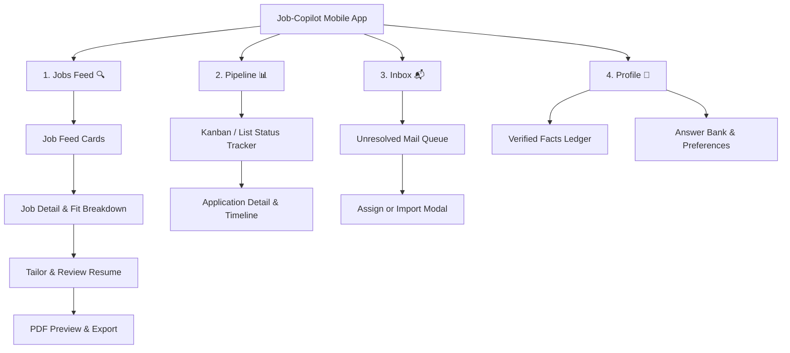
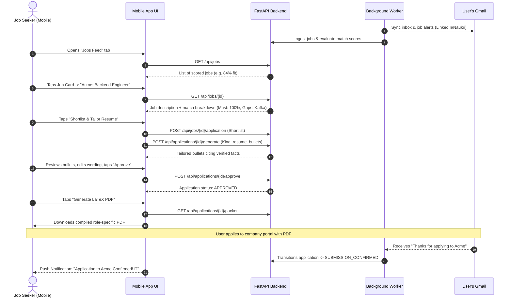

# Job-Copilot — Mobile App Wireflow & Architecture Guide

This document defines the complete mobile application wireflow, screen layouts, navigation architecture, and backend API mapping for **Job-Copilot**.

---

## 1. High-Level Mobile Navigation Structure

The mobile app follows a standard bottom-tab navigation with **4 main tabs**:



---

## 2. End-to-End User Workflow (Mermaid Diagram)



---

## 3. Screen-by-Screen Wireframes & Layouts

### Screen 1: Jobs Feed (`Discover`)

Shows new opportunities gathered from ATS boards or Gmail alerts, ranked by your computed fit score.

```
┌──────────────────────────────────────────────┐
│  JOB-COPILOT                         [ 🔍 ]  │
│  Daily Feed — 12 New Matches                 │
├──────────────────────────────────────────────┤
│  ┌────────────────────────────────────────┐  │
│  │  Senior Backend Engineer               │  │
│  │  Acme Corp • Bengaluru (Hybrid)        │  │
│  │  Score: 88%  🟢 High Fit               │  │
│  │  Matched: Python, PostgreSQL, REST     │  │
│  │  Missing: Kafka (Preferred)            │  │
│  │                                        │  │
│  │  [ Pass ]            [ View & Tailor ] │  │
│  └────────────────────────────────────────┘  │
│                                              │
│  ┌────────────────────────────────────────┐  │
│  │  Platform Engineer                     │  │
│  │  TechCorp • Remote                     │  │
│  │  Score: 62%  🟡 Moderate Fit           │  │
│  │  Matched: Docker, Linux                │  │
│  │  Missing: Kubernetes (Must-have)       │  │
│  │                                        │  │
│  │  [ Pass ]            [ View & Tailor ] │  │
│  └────────────────────────────────────────┘  │
├──────────────────────────────────────────────┤
│   [🔍 Feed]    [📊 Pipeline]   [📬 Inbox]    │
└──────────────────────────────────────────────┘
```

* **API Endpoints**:
  - `GET /api/jobs?limit=50`: Fetches list of scored jobs with company, title, score, and freshness.
  - `POST /api/jobs`: Manual paste floating action button (`+ Paste Job`).

---

### Screen 2: Job Breakdown & Scorecard

Tapping any card reveals the deterministic scoring breakdown—no black-box AI.

```
┌──────────────────────────────────────────────┐
│  < Back to Feed                 Acme Corp    │
│  Senior Backend Engineer                     │
├──────────────────────────────────────────────┤
│  OVERALL FIT: 88% / 100                      │
│  [=============================-----]        │
│                                              │
│  REQUIREMENTS BREAKDOWN:                     │
│  ✓ MUST: 4+ Years Experience (You have 4.5)  │
│  ✓ MUST: Python / FastAPI (Fact #12, #14)    │
│  ✓ MUST: PostgreSQL Database Design (Fact #8)│
│  ✓ PREFERRED: Docker & CI/CD (Fact #19)      │
│  ⚠ GAP: Kafka Event Streaming (No fact)     │
│                                              │
│  SALARY & WORK MODE:                         │
│  • Work Mode: Hybrid (Bengaluru)             │
│  • Comp Range: ₹28L - ₹35L (Passes floor)    │
│                                              │
│  ┌────────────────────────────────────────┐  │
│  │   [ ⚡ Shortlist & Tailor Resume ]     │  │
│  └────────────────────────────────────────┘  │
└──────────────────────────────────────────────┘
```

* **API Endpoints**:
  - `GET /api/jobs/{job_id}`: Returns job details, requirements, and mapped evaluations.
  - `POST /api/jobs/{job_id}/application`: Transitions job into `SHORTLISTED`.

---

### Screen 3: Tailored Content Review & Fact Verification

The user reviews the generated bullets. Every bullet shows which verified fact it cites.

```
┌──────────────────────────────────────────────┐
│  < Back                  Tailor Application  │
│  Reviewing Bullets for Acme Corp             │
├──────────────────────────────────────────────┤
│  DOCUMENT: Resume Bullets (v1)               │
│  Status: Validated (0 Hallucinations) 🛡️     │
│                                              │
│  ┌─ Bullet 1 ──────────────────────────────┐ │
│  │ "Architected low-latency FastAPI        │ │
│  │  microservices handling 10k req/s with  │ │
│  │  sub-50ms response times."              │ │
│  │  Cites: [Fact #12: FastAPI Services]    │ │
│  │  [ Edit ]                               │ │
│  └─────────────────────────────────────────┘ │
│                                              │
│  ┌─ Bullet 2 ──────────────────────────────┐ │
│  │ "Optimized PostgreSQL indexing and      │ │
│  │  query patterns, reducing database load │ │
│  │  by 35% across production clusters."    │ │
│  │  Cites: [Fact #8: Database Perf]        │ │
│  │  [ Edit ]                               │ │
│  └─────────────────────────────────────────┘ │
│                                              │
│  [ + Regenerate ]        [ ✅ Approve Packet ]│
└──────────────────────────────────────────────┘
```

* **API Endpoints**:
  - `POST /api/applications/{app_id}/generate`: Calls the generator with `DocumentKind.RESUME_BULLETS`.
  - `PUT /api/applications/{app_id}/documents/resume_bullets`: Saves manual user edits (validated on-the-fly).
  - `POST /api/applications/{app_id}/approve`: Marks application as `APPROVED`.

---

### Screen 4: Application Pipeline (`Lifecycle Tracker`)

Tracks every application through confirmed stages.

```
┌──────────────────────────────────────────────┐
│  APPLICATIONS PIPELINE                       │
│  All Active (18)                             │
├──────────────────────────────────────────────┤
│  [ Shortlisted (3) ] [ Approved (2) ]        │
│  [ Confirmed (9) ]   [ Interviews (2) 🔥 ]   │
├──────────────────────────────────────────────┤
│  INTERVIEWS (2)                              │
│  ┌────────────────────────────────────────┐  │
│  │ Stripe — Senior Backend                │  │
│  │ Stage: Technical Round 1 (15 Oct)      │  │
│  │ Evidence: Email from recruiter@stripe  │  │
│  └────────────────────────────────────────┘  │
│                                              │
│  SUBMISSIONS CONFIRMED (9)                   │
│  ┌────────────────────────────────────────┐  │
│  │ Acme Corp — Backend Engineer           │  │
│  │ Submitted: 12 Oct (Greenhouse)         │  │
│  │ Evidence: "Thank you for applying"     │  │
│  └────────────────────────────────────────┘  │
│                                              │
│  NEEDS MANUAL ACTION (1)                     │
│  ┌────────────────────────────────────────┐  │
│  │ Swiggy — Engineering Lead              │  │
│  │ Note: Generation retry limit reached   │  │
│  │ [ Open Manual Queue ]                  │  │
│  └────────────────────────────────────────┘  │
├──────────────────────────────────────────────┤
│   [🔍 Feed]    [📊 Pipeline]   [📬 Inbox]    │
└──────────────────────────────────────────────┘
```

* **API Endpoints**:
  - `GET /api/applications`: Filter by status (`AppStatus`).
  - `GET /api/applications/{id}`: Returns full audit history, attached evidence items, and documents.

---

### Screen 5: Inbox Resolution Queue

Whenever an email from a recruiter or job board cannot be 100% matched automatically, it appears here for a quick 1-tap resolution.

```
┌──────────────────────────────────────────────┐
│  INBOX RESOLUTION                      [ ⟳ ] │
│  3 items require your attention              │
├──────────────────────────────────────────────┤
│  ┌────────────────────────────────────────┐  │
│  │ From: hiring@fintech-inc.com           │  │
│  │ Subject: Next steps for your profile   │  │
│  │ Detected: Interview / Assessment       │  │
│  │                                        │  │
│  │ [ Assign to Existing App ]             │  │
│  │ [ Import as New Application ]          │  │
│  │ [ Dismiss ]                            │  │
│  └────────────────────────────────────────┘  │
├──────────────────────────────────────────────┤
│   [🔍 Feed]    [📊 Pipeline]   [📬 Inbox]    │
└──────────────────────────────────────────────┘
```

* **API Endpoints**:
  - `GET /api/inbox`: Fetches unresolved inbound messages.
  - `POST /api/inbox/{id}/assign`: Links email to an existing application.
  - `POST /api/inbox/{id}/import`: Tracks an application made externally.
  - `POST /api/inbox/{id}/dismiss`: Dismisses unrelated notifications.

---

## 4. LaTeX Resume Export on Mobile

When the user taps **"Export LaTeX PDF"** on the mobile app:

```
[ Mobile App ]
      │  Taps "Download PDF"
      ▼
[ GET /api/applications/{id}/packet ]
      │  Returns { "resume_bullets": ["...", "..."], "job_title": "..." }
      ▼
[ Backend / Export Worker ]
      │  Injects bullets into user's `template.tex`
      │  Runs `pdflatex` or `tectonic`
      ▼
[ Generated PDF Response ]
      │
      ▼
[ Mobile App opens native PDF Share Sheet (Files / WhatsApp / AirDrop) ]
```

---

## 5. Recommended Mobile Tech Stack

| Component | Recommendation | Rationale |
|---|---|---|
| **Framework** | **Flutter** (Dart) or **React Native** (Expo) | Cross-platform (iOS + Android), fast prototyping, great animation support. |
| **Networking** | `dio` (Flutter) or `axios` / `react-query` (React) | Native support for Bearer token interceptors, query caching, and file downloading. |
| **State Management** | Riverpod / Bloc (Flutter) or Zustand (React) | Predictable state updates for application pipelines and optimistic UI. |
| **PDF Viewer** | `flutter_pdfview` or `react-native-pdf` | In-app preview of the compiled tailored LaTeX resume. |
